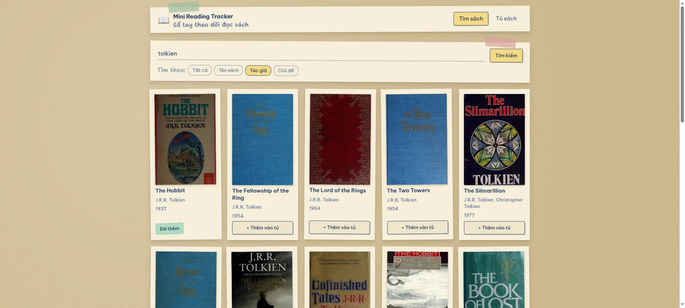
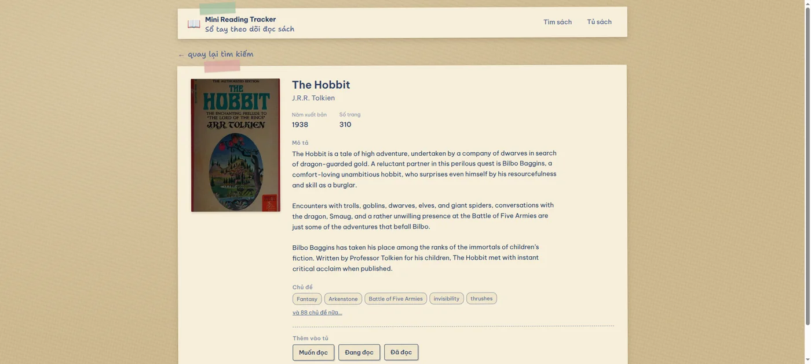
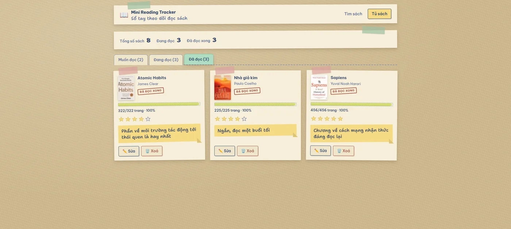
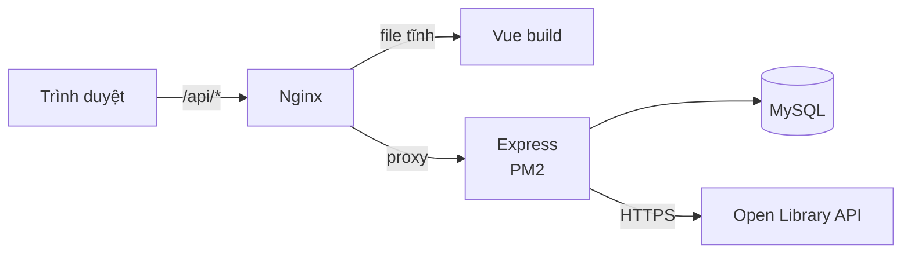
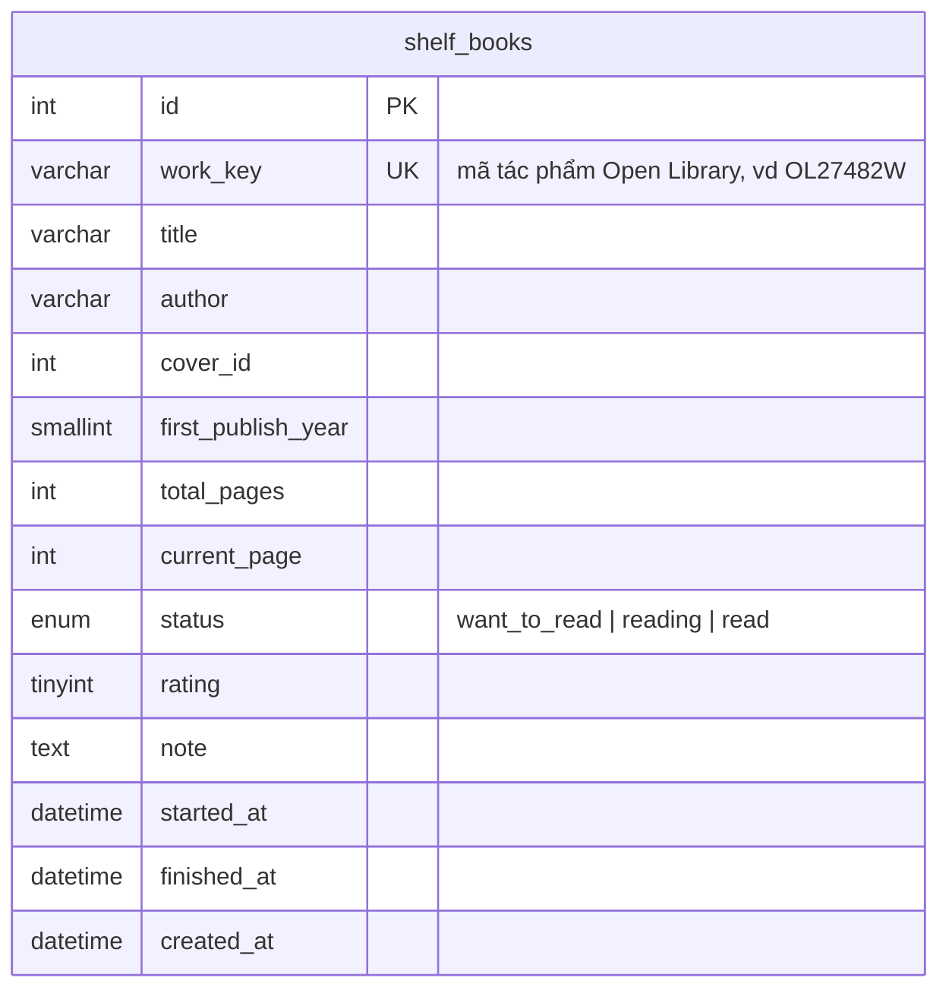

# Mini Reading Tracker

Ứng dụng web theo dõi việc đọc sách cá nhân: tìm sách qua Open Library, lưu vào tủ sách riêng, cập nhật tiến độ đọc, đánh giá và ghi chú.

**Demo:** https://reading.bangth.org · **API:** https://reading.bangth.org/api/health

| Tìm kiếm | Chi tiết sách | Tủ sách |
|---|---|---|
|  |  |  |

## Công nghệ sử dụng

Vue, Node.js và MySQL là ràng buộc của đề. Những gì còn lại là lựa chọn:

| Lớp | Công nghệ | Chọn gì trong đó |
|---|---|---|
| Frontend | Vue 3 + Vite + Vue Router + axios | Composition API thay cho Options API. Không thêm Pinia: state không chia sẻ chéo màn nào, `ref` trong từng view là đủ |
| Backend | Express | Thay cho Nest — 9 endpoint thì tầng module và DI chỉ thêm việc |
| Truy vấn DB | `mysql2`, SQL thuần | Không ORM: 9 câu truy vấn, viết tay thì đọc được và biết chính xác index nào được dùng |
| Test | `node:test` | Có sẵn từ Node 18, không phải thêm Jest hay Vitest |
| Deploy | 1 VPS: Nginx + PM2 + Let's Encrypt | Gom một máy, ít điểm hỏng, và tự tay dựng được từ đầu |

Bốn chỗ hay bị thêm dependency theo quán tính mà ở đây không thêm: ORM, thư
viện validate, `dotenv` (Node ≥ 20.6 đã có `--env-file`), và HTTP client phía
server (`fetch` có sẵn từ Node 18).

## Chạy local

Cần: Node ≥ 20, Docker (hoặc MySQL cài sẵn).

```bash
# 1. Dựng MySQL
docker run -d --name mini-reading-tracker-mysql \
  -e MYSQL_ROOT_PASSWORD='<mật khẩu>' \
  -e MYSQL_DATABASE=reading_tracker \
  -p 127.0.0.1:3412:3306 \
  mysql:8.4

# 2. Backend
cd backend
cp .env.example .env     # điền mật khẩu DB vừa đặt
npm install
npm run db:migrate
npm run db:seed
npm run dev              # http://localhost:3000

# 3. Frontend (terminal khác)
cd frontend
npm install
npm run dev              # http://localhost:5173
```

## Chạy test

```bash
cd backend && npm test     # 52 test: quy tắc nghiệp vụ + validate ở route
cd frontend && npm test    # 9 test: dựng payload PATCH + luật hỏi xác nhận
cd backend && npm run lint
```

Test backend **không cần MySQL đang chạy**: chúng chỉ chạm vào nhánh validate,
vốn trả lỗi trước khi gọi DB. Các nhánh có chạm DB — thêm sách thành công, 409
khi trùng, thống kê, và toàn bộ luồng trên ba màn hình — được kiểm thủ công
bằng trình duyệt thật, đối chiếu lại bảng `shelf_books` sau mỗi thao tác.

## Kiến trúc



Trình duyệt không gọi Open Library trực tiếp; ảnh bìa cũng đi qua
`/api/covers/:coverId`. Nhờ vậy chỉ có một origin, không phải cấu hình CORS, và
backend là nơi duy nhất biết về Open Library.

### Sơ đồ database



Một bảng là đủ: ứng dụng cho một người dùng, không có quan hệ nào cần tách ra.
`author`, `cover_id`, `first_publish_year` và `total_pages` cho phép `NULL` vì
Open Library hay thiếu đúng những trường này; `rating`, `note`, `started_at` và
`finished_at` cho phép `NULL` vì người dùng điền dần về sau.

## Danh sách API

| Method | Path | Mô tả | Lỗi có thể trả |
|---|---|---|---|
| GET | `/api/health` | Kiểm tra server sống | — |
| GET | `/api/books/search?q=&page=&field=` | Tìm sách. `field` nhận `all\|title\|author\|subject\|isbn\|first_publish_year\|publish_year`, mặc định `all`. Kèm cờ `inShelf` cho từng kết quả | 400, 502 |
| GET | `/api/books/:workId` | Chi tiết một tác phẩm, kèm `totalPages` | 400, 404, 502 |
| GET | `/api/covers/:coverId?size=S\|M\|L` | Proxy ảnh bìa | 400, 404, 502 |
| POST | `/api/shelf` | Thêm sách vào tủ | 400, **409 nếu trùng** |
| GET | `/api/shelf?status=` | Danh sách sách trong tủ, lọc theo trạng thái | 400 |
| GET | `/api/shelf/stats` | Thống kê: tổng, đang đọc, đã đọc | — |
| PATCH | `/api/shelf/:id` | Cập nhật tiến độ, trạng thái, đánh giá, ghi chú | 400, 404 |
| DELETE | `/api/shelf/:id` | Xoá khỏi tủ | 404 |
| — | đường dẫn `/api` khác | Không khớp route nào | 404 `NOT_FOUND` |

Mọi lỗi dùng chung một hình dạng:

```json
{
  "error": {
    "code": "VALIDATION_ERROR",
    "message": "Dữ liệu không hợp lệ",
    "details": [{ "field": "rating", "message": "Đánh giá phải là số nguyên từ 1 đến 5, hoặc để trống" }]
  }
}
```

`details` chỉ xuất hiện với lỗi validate. Lỗi hệ thống (500) không lộ chi tiết ra ngoài.
Body không phải JSON hợp lệ trả **400 `INVALID_JSON`**, và endpoint không tồn tại trả
**404 `NOT_FOUND`** — cùng hình dạng, không rơi về trang lỗi mặc định của Express.

## Quy tắc nghiệp vụ

1. Không thêm trùng sách — ràng buộc `UNIQUE` trên `work_key`, API trả **409**.
2. `0 ≤ current_page ≤ total_pages` (khi biết tổng số trang), và luôn ≤ 10.000
   kể cả khi chưa biết tổng.
3. `note` phải là chuỗi, tối đa 2.000 ký tự.
4. `rating` là số nguyên 1–5 hoặc để trống.
5. Cập nhật `current_page` chạm tới `total_pages` → tự chuyển sang *Đã đọc*,
   kể cả khi request nói rõ một trạng thái khác. Chỉ đổi mỗi trạng thái
   (đọc lại cuốn cũ) thì không tính, vì không phải vừa đọc tới trang cuối.
6. Chuyển sang *Đang đọc* lần đầu → ghi `started_at`; chuyển sang *Đã đọc* → ghi `finished_at`.
7. Lùi về *Muốn đọc* → `current_page` về 0 và xoá cả hai mốc; `rating` giữ
   nguyên vì nó nói về cuốn sách, không phải tiến độ.
8. Đánh giá được cho sách ở mọi trạng thái, không chỉ sách đã đọc xong.
9. Toàn bộ validate nằm ở backend.

## Deploy

Toàn bộ chạy trên **một VPS Ubuntu 22.04**, sau một Nginx duy nhất:

| Thành phần | Cách chạy |
|---|---|
| Frontend | `vite build` ra file tĩnh, Nginx phục vụ từ `/var/www/reading-tracker` |
| Backend | Express chạy dưới PM2 (`fork` mode), nghe cổng 3000 |
| Nginx | phục vụ file tĩnh, proxy `/api` sang cổng 3000, `try_files` về `index.html` để F5 ở route sâu không 404 |
| MySQL | cài thẳng trên VPS, dùng user riêng (không phải `root`) |
| HTTPS | Let's Encrypt qua `certbot`; `http://` chuyển 301 sang `https://` |

Các bước đã làm một lần lúc dựng: tạo DB + user riêng, điền `backend/.env` trên
server (file này không nằm trong repo), trỏ DNS A record về IP VPS, chạy
`certbot`.

Từ đó về sau mỗi lần deploy chỉ cần SSH vào rồi chạy:

```bash
cd /opt/reading-tracker && ./deploy/deploy.sh
```

Script sẽ `git pull --ff-only` → `npm ci` → `npm run db:migrate` → build frontend
→ chép sang thư mục Nginx → `pm2 reload` → gọi thử `/api/health`.

### Dữ liệu mẫu

Khi DB còn trống — lần đầu dựng server, hoặc muốn có sẵn vài cuốn để thử:

```bash
cd backend && npm run db:seed
```

Nạp 8 cuốn sách thật lấy từ Open Library, đủ cả ba trạng thái, trong đó có một
cuốn không có số trang để xem giao diện xử lý dữ liệu thiếu ra sao. Lệnh này xoá
sạch bảng trước khi chèn, nên chỉ chạy khi chưa có dữ liệu cần giữ.

Cấu hình mẫu nằm trong `deploy/`:
- `deploy/nginx.conf.example` — Nginx phục vụ file tĩnh + proxy `/api`
- `deploy/deploy.sh` — kéo code, chạy migration, build frontend, nạp lại PM2
- `backend/ecosystem.config.js` — cấu hình PM2

## Giả định, hạn chế và hướng cải thiện

### Giả định

**Một người dùng, không đăng nhập.** Theo yêu cầu của đề bài, từ đó nó quyết
định schema: ràng buộc `UNIQUE` đặt trên một mình `work_key`. Nếu sau này mở cho
nhiều người thì phải đổi thành `UNIQUE(user_id, work_key)`, vì hai người đọc
đều có thể thêm cùng một cuốn sách.

**Open Library là nguồn sự thật cho thông tin sách**, còn tủ sách là dữ liệu
của riêng ứng dụng. Tên sách, tác giả, ảnh bìa được chép lại vào DB tại thời
điểm thêm — nếu bên đó sửa dữ liệu sau này thì tủ sách không tự cập nhật theo.
Đổi lại, mở màn hình tủ sách chỉ cần một câu `SELECT`: Open Library có sập thì
tên sách, tiến độ, ghi chú vẫn xem được bình thường, chỉ riêng ảnh bìa là hiện
ô giấy trống vì ảnh vẫn phải tải từ bên đó về.

### Quyết định thiết kế

**Chỉ một bảng.** Không tách bảng tác giả vì ứng dụng không bao giờ truy vấn
theo tác giả — nó chỉ hiển thị chuỗi tên. Tách ra sẽ thêm một bảng, một bảng
nối và một phép `JOIN` cho mỗi lần đọc, đổi lấy đúng một thứ ta không dùng.
Open Library cũng trả tác giả theo từng tác phẩm chứ không có định danh ổn định
tiện để nối.

**Tám cột cho phép `NULL`, chia làm hai nhóm.** Nhóm thứ nhất là bốn trường
Open Library có thể không có: `author` (truyện dân gian không ghi tác giả),
`cover_id`, `first_publish_year` và `total_pages`. Riêng số trang đáng chú ý —
endpoint `works/{id}.json` không trả trường này, chỉ bộ tìm kiếm mới có
`number_of_pages_median`, nên màn chi tiết phải hỏi riêng chỉ số tìm kiếm theo
đúng work key.

Nhóm thứ hai là bốn trường người dùng điền dần: `rating`, `note`, `started_at`
và `finished_at`. Chúng `NULL` khi sách vừa vào tủ và có giá trị khi người dùng
chấm điểm, ghi chú, hoặc bắt đầu và đọc xong.

**Validate và quy tắc nghiệp vụ nằm trọn ở backend**, gom trong một hàm thuần
`applyChanges` không chạm DB và không biết Express. Nhờ vậy toàn bộ quy tắc
nghiệp vụ kiểm được bằng unit test không cần dựng MySQL, và hai đường ghi dữ
liệu (thêm sách và sửa sách) dùng chung đúng một bộ luật nên không thể lệch
nhau.

**Gửi lên chỉ những field thực sự đổi.** Gửi kèm field không đổi là tự tạo lỗi:
`PATCH` một cuốn 310 trang với `{ status: "read", currentPage: 180 }` bị trả 400
vì hai thứ mâu thuẫn, trong khi bỏ `currentPage` ra thì backend tự nâng lên 310
theo quy tắc.

### Hạn chế đã biết

**API hoàn toàn mở.** Hệ quả trực tiếp của việc không có đăng nhập: ai có URL
đều gọi được `DELETE /api/shelf/:id` và xoá sạch tủ sách. Chấp nhận được với một
bài test, nhưng là thứ đầu tiên phải sửa nếu dùng thật.

**Dữ liệu Open Library không đồng đều.** Nhiều tác phẩm thiếu số trang, ảnh bìa
hoặc tên tác giả — đó là lý do bốn cột đó trong bảng cho phép `NULL`. Giao diện xử
lý từng trường hợp: thiếu tổng số trang thì ẩn thanh tiến độ và chỉ ghi "đã đọc
đến trang N", thiếu bìa thì vẽ ô giấy mang tên sách, thiếu tác giả thì ghi
"Không rõ tác giả".

Riêng số trang kéo theo một hệ quả: khi Open Library không có, ứng dụng lấy số
trang người dùng nhập lúc đánh dấu "Đã đọc" làm tổng. Gõ nhầm thì cuốn đó mang
tổng sai, mà màn hình chỉ cho sửa *số trang đang đọc* — phải xoá đi thêm lại.

**Số trang chặn cứng ở 10.000.** Khi không biết tổng số trang thì không có gì
để đối chiếu, nên phải có một trần tuyệt đối. Trần bắt buộc nằm dưới giới hạn
của cột `INT` là 2.147.483.647 — vượt qua đó thì MySQL ném lỗi, biến một con số
gõ nhầm của người dùng thành lỗi 500. Chọn 10.000 vì cuốn dày nhất trong dữ
liệu mẫu là *The Lord of the Rings* 1.193 trang, nên trần vẫn rộng gấp tám lần
mà chặn được số gõ nhầm.

**Tìm một ký tự ở phạm vi "Tất cả" có thể lỗi.** Lỗi đến từ Open Library chứ
không phải ứng dụng — gọi thẳng API của họ cũng trả 500. Màn hình hiện khối báo
lỗi kèm nút Thử lại thay vì im lặng.

### Hướng cải thiện nếu có thêm thời gian

**Đăng nhập và nhiều người dùng** — việc đầu tiên, vì nó mở khoá mọi thứ khác và
chỉ cần đổi một ràng buộc `UNIQUE` cùng một cột `user_id`.

**Bù nguồn dữ liệu.** Khi Open Library thiếu số trang hoặc ảnh bìa, đối chiếu
thêm một nguồn thứ hai (Google Books có cả hai trường này), và cho người dùng tự
sửa nếu cả hai nguồn đều thiếu. Đây là gốc của phần lớn chỗ trống trên giao
diện, nên sửa được nó là sửa được nhiều thứ cùng lúc.

**Chat AI hỗ trợ tìm sách** — mô tả đại khái "cuốn trinh thám Bắc Âu có nữ thám
tử" rồi để mô hình dịch sang truy vấn Open Library. Cố ý không làm trong phạm vi
bài test.

**Gợi ý tức thời khi gõ (autocomplete)** — đã cân nhắc và **quyết định không
làm**: Open Library trả lời mất 1–2 giây, chậm hơn tốc độ gõ của người dùng,
nên gợi ý sẽ luôn hiện sau khi họ đã gõ xong.

**Lưu đệm kết quả tìm kiếm** để đỡ gọi lại Open Library cho cùng một từ khoá, và
giảm ảnh hưởng của những lần API bên đó chập chờn.
