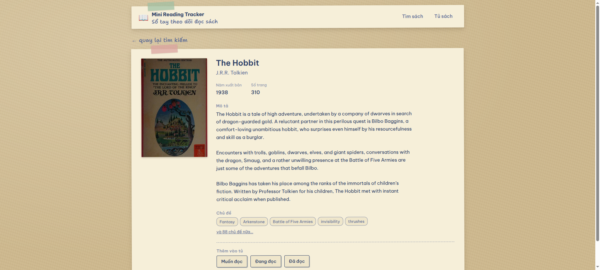
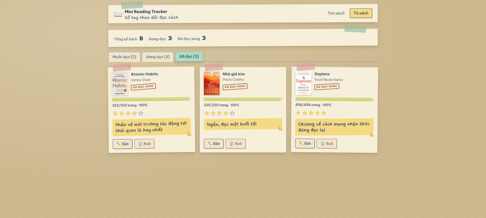
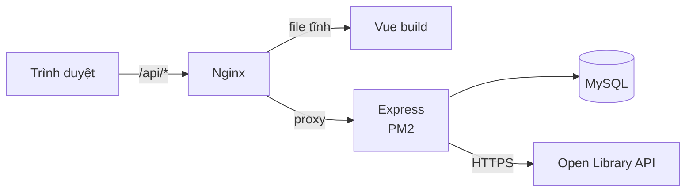
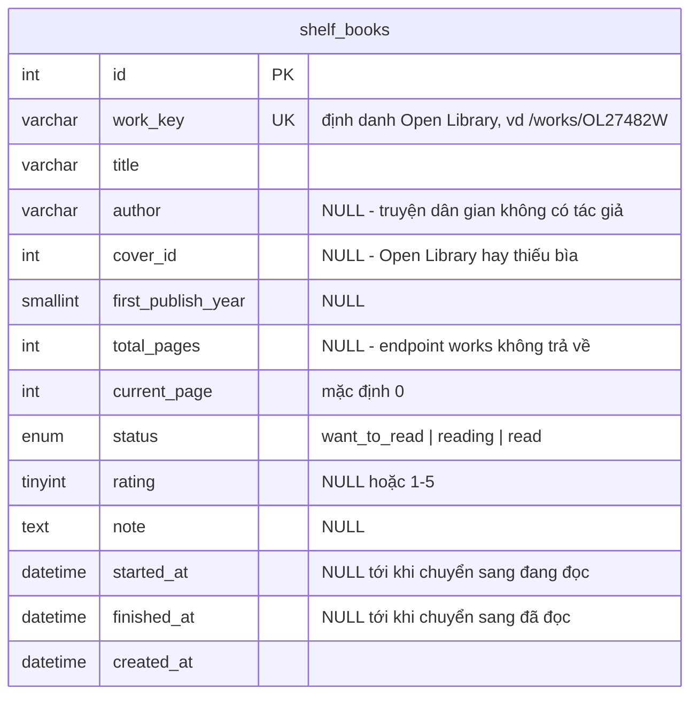

# Mini Reading Tracker

Ứng dụng web theo dõi việc đọc sách cá nhân: tìm sách qua Open Library, lưu vào tủ sách riêng, cập nhật tiến độ đọc, chấm sao và ghi chú.

**Demo:** https://reading.bangth.org · **API:** https://reading.bangth.org/api/health

| Tìm kiếm | Chi tiết sách | Tủ sách |
|---|---|---|
|  |  |  |

## Công nghệ sử dụng

| Lớp | Công nghệ | Lý do chọn |
|---|---|---|
| Frontend | Vue 3 (Composition API) + Vite + Vue Router + axios | Đề yêu cầu Vue. Không dùng Pinia vì state của app nhỏ, không chia sẻ chéo nhiều màn |
| Backend | Node.js + Express | Đề yêu cầu Node.js |
| Database | MySQL 8.4 | Đề yêu cầu MySQL |
| Truy vấn DB | `mysql2` viết SQL thuần | Không dùng ORM để kiểm soát và giải thích được từng câu truy vấn |
| Test | `node:test` (có sẵn trong Node) | Không thêm dependency cho việc vốn đã có công cụ sẵn |
| Deploy | VPS Ubuntu 22 + Nginx + PM2 + Let's Encrypt | Gom một máy, ít điểm hỏng |

Các thư viện cố ý **không** dùng: ORM, thư viện validate (tự viết), `dotenv` (Node ≥ 20.6 có `--env-file`), thư viện HTTP client phía server (`fetch` có sẵn).

## Chạy local

Cần: Node ≥ 20, Docker (hoặc MySQL cài sẵn).

```bash
# 1. Dựng MySQL
docker run -d --name mini-reading-tracker-mysql \
  -e MYSQL_ROOT_PASSWORD='<mật khẩu>' \
  -e MYSQL_DATABASE=reading_tracker \
  -p 127.0.0.1:3412:3306 \
  mysql:8.4

# 2. Backend
cd backend
cp .env.example .env     # điền mật khẩu DB vừa đặt
npm install
npm run db:migrate
npm run db:seed
npm run dev              # http://localhost:3000

# 3. Frontend (terminal khác)
cd frontend
npm install
npm run dev              # http://localhost:5173
```

Mở http://localhost:5173.

## Kiến trúc



Frontend **không bao giờ** gọi thẳng Open Library — kể cả ảnh bìa cũng đi qua `/api/covers/:coverId`. Nhờ vậy trình duyệt chỉ nói chuyện với một origin duy nhất, không cần cấu hình CORS, và backend là nơi duy nhất biết về Open Library.

### Sơ đồ database



Chỉ một bảng, vì app dành cho một người dùng và không có quan hệ nào cần tách. Lý do chi tiết cho từng quyết định (vì sao `work_key` mang ràng buộc `UNIQUE`, vì sao tác giả không tách bảng, vì sao bốn cột cho phép `NULL`) nằm ở phần Giả định & Quyết định thiết kế bên dưới.

## Danh sách API

| Method | Path | Mô tả | Lỗi có thể trả |
|---|---|---|---|
| GET | `/api/health` | Kiểm tra server sống | — |
| GET | `/api/books/search?q=&page=&field=` | Tìm sách theo `all\|title\|author\|subject\|isbn\|…`, kèm cờ `inShelf` | 400, 502 |
| GET | `/api/books/:workId` | Chi tiết một tác phẩm, kèm `totalPages` | 400, 404, 502 |
| GET | `/api/covers/:coverId?size=S\|M\|L` | Proxy ảnh bìa | 400, 404, 502 |
| POST | `/api/shelf` | Thêm sách vào tủ | 400, **409 nếu trùng** |
| GET | `/api/shelf?status=` | Danh sách sách trong tủ, lọc theo trạng thái | 400 |
| GET | `/api/shelf/stats` | Thống kê: tổng, đang đọc, đã đọc | — |
| PATCH | `/api/shelf/:id` | Cập nhật tiến độ, trạng thái, sao, ghi chú | 400, 404 |
| DELETE | `/api/shelf/:id` | Xoá khỏi tủ | 404 |
| — | đường dẫn `/api` khác | Không khớp route nào | 404 `NOT_FOUND` |

Mọi lỗi dùng chung một hình dạng:

```json
{
  "error": {
    "code": "VALIDATION_ERROR",
    "message": "Dữ liệu không hợp lệ",
    "details": [{ "field": "rating", "message": "Rating phải là số nguyên 1-5 hoặc null" }]
  }
}
```

`details` chỉ xuất hiện với lỗi validate. Lỗi hệ thống (500) không lộ chi tiết ra ngoài.
Body không phải JSON hợp lệ trả **400 `INVALID_JSON`**, và endpoint không tồn tại trả
**404 `NOT_FOUND`** — cùng hình dạng, không rơi về trang lỗi mặc định của Express.

## Quy tắc nghiệp vụ

1. Không thêm trùng sách — ràng buộc `UNIQUE` trên `work_key`, API trả **409**.
2. `0 ≤ current_page ≤ total_pages` (khi biết tổng số trang).
3. `rating` là số nguyên 1–5 hoặc để trống.
4. Cập nhật `current_page` chạm tới `total_pages` → tự chuyển sang *Đã đọc*,
   kể cả khi request nói rõ một trạng thái khác. Chỉ đổi mỗi trạng thái
   (đọc lại cuốn cũ) thì không tính, vì không phải vừa đọc tới trang cuối.
5. Chuyển sang *Đang đọc* lần đầu → ghi `started_at`; chuyển sang *Đã đọc* → ghi `finished_at`.
6. Lùi về *Muốn đọc* → `current_page` về 0 và xoá cả hai mốc; `rating` giữ
   nguyên vì nó nói về cuốn sách, không phải tiến độ.
7. Chấm sao được cho sách ở **mọi** trạng thái, không chỉ sách đã đọc xong.
8. Toàn bộ validate nằm ở backend.

## Deploy

Toàn bộ chạy trên **một VPS Ubuntu 22.04**, sau một Nginx duy nhất:

| Thành phần | Cách chạy |
|---|---|
| Frontend | `vite build` ra file tĩnh, Nginx phục vụ từ `/var/www/reading-tracker` |
| Backend | Express chạy dưới PM2 (`fork` mode), nghe cổng 3000 |
| Nginx | phục vụ file tĩnh, proxy `/api` sang cổng 3000, `try_files` về `index.html` để F5 ở route sâu không 404 |
| MySQL | cài thẳng trên VPS, dùng user riêng (không phải `root`) |
| HTTPS | Let's Encrypt qua `certbot`; `http://` chuyển 301 sang `https://` |

Các bước đã làm một lần lúc dựng: tạo DB + user riêng, điền `backend/.env` trên
server (file này không nằm trong repo), trỏ DNS A record về IP VPS, chạy
`certbot`, rồi `npm run db:seed` để có dữ liệu mẫu.

Từ đó về sau mỗi lần deploy chỉ cần SSH vào rồi chạy:

```bash
cd /opt/reading-tracker && ./deploy/deploy.sh
```

Script sẽ `git pull --ff-only` → `npm ci` → `npm run db:migrate` → build frontend
→ chép sang thư mục Nginx → `pm2 reload` → gọi thử `/api/health`.

> `deploy.sh` **không** chạy `db:seed`. Seed sẽ xoá sạch bảng trước khi chèn, nên
> nó là việc dựng một lần, không phải việc của mỗi lần deploy.

Cấu hình mẫu nằm trong `deploy/`:
- `deploy/nginx.conf.example` — Nginx phục vụ file tĩnh + proxy `/api`
- `deploy/deploy.sh` — kéo code, chạy migration, build frontend, nạp lại PM2
- `backend/ecosystem.config.js` — cấu hình PM2

## Giả định, hạn chế và hướng cải thiện


## Chạy test

```bash
cd backend && npm test
```
